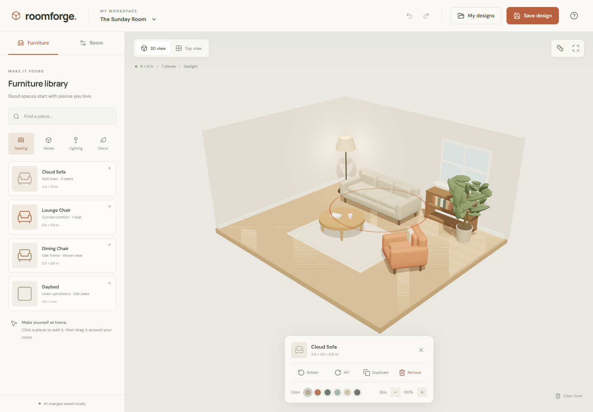

# 🛋️ RoomForge 3D

<p align="center">
  
</p>

<p align="center">
  <strong>Your space, reimagined. Fast, interactive 3D interior design in the browser.</strong><br>
  Zero accounts. Zero backends. 100% private and client-side.
</p>

<p align="center">
  
  
  
  
  
  
</p>

---

## 🌟 Highlights

- **Interactive 3D Viewport:** Free orbit, smooth zoom, instant top-down 2D orthographic plan, dynamic floor grid, and live room dimension callouts.
- **15-Piece Procedural Catalog:** Seating, desks, dining tables, shelving, ceiling/floor lighting, plants, electronics, appliances, doors, and windows.
- **Smart Wall Snapping:** Doors and windows dynamically puncture custom openings in room walls. Wall-mounted furniture locks to boundaries automatically.
- **Precision Customization:** Resize room width & depth (3–12m), tweak wall & floor finishes, adjust ambient & directional lighting, and scale furniture (60%–140%).
- **Non-Destructive Editing:** Full undo/redo history (`Ctrl+Z` / `Ctrl+Shift+Z`), quick duplicate, color palette picker, and one-click room clearing.
- **Privacy First & Local Storage:** No server sync required. All rooms save directly to browser `localStorage` (supports up to 20 named projects).

---

## 🎮 Interactive Controls

| Action | Mouse / Touch | Keyboard |
| :--- | :--- | :--- |
| **Orbit Camera** | Click & drag on empty canvas | — |
| **Zoom In / Out** | Mouse scroll wheel or pinch | — |
| **Move Furniture** | Click & drag furniture piece | — |
| **Rotate Selected** | Click rotate buttons in floating HUD | <kbd>R</kbd> |
| **Remove Selected** | Click trash button | <kbd>Delete</kbd> or <kbd>Backspace</kbd> |
| **Undo Edits** | Click Undo icon | <kbd>Ctrl</kbd> + <kbd>Z</kbd> / <kbd>Cmd</kbd> + <kbd>Z</kbd> |
| **Redo Edits** | Click Redo icon | <kbd>Ctrl</kbd> + <kbd>Shift</kbd> + <kbd>Z</kbd> |
| **Deselect Item** | Click empty canvas | <kbd>Escape</kbd> |

---

## ⚡ Quick Start

### Prerequisites
- [Node.js](https://nodejs.org/) (v22.0.0 or later recommended)
- `npm` (v10+ or package manager of choice)
- Modern browser with WebGL 2 enabled

### Installation

```bash
# 1. Clone repository
git clone https://github.com/risterz/RoomForge-3D.git
cd RoomForge-3D

# 2. Install dependencies
npm install

# 3. Start local development server
npm run dev
```

Open **`http://localhost:5173`** in your browser.

### Production Build

```bash
npm run build
npm run preview
```

Static production assets compile directly into the `dist/` directory, ready to deploy to Cloudflare Pages, Vercel, Netlify, or GitHub Pages.

---

## 🏗️ Architecture & Mechanics

```
RoomForge/
├── public/                  # Static assets & favicon
├── src/
│   ├── App.tsx              # Root state machine, undo/redo stack & persistence
│   ├── Scene.tsx            # Three.js canvas, lighting, camera controls & room bounds
│   ├── Furniture.tsx        # Procedural 3D mesh definitions & raycast drag handlers
│   ├── FurniturePreview.tsx # 2D/3D catalog visual representations
│   ├── wallPlacement.ts     # Boundary clamping, wall snapping & orientation math
│   ├── data.ts              # Catalog presets, starter room schema & validators
│   ├── types.ts             # Strict TypeScript domain models
│   ├── styles.css           # Glassmorphism UI & responsive design
│   └── main.tsx             # Application bootstrap
├── tests/                   # Automated Playwright test suite
├── package.json
└── vite.config.ts
```

### Technical Design Principles
1. **Procedural Geometry:** No heavy GLTF/OBJ downloads. Meshes are constructed programmatically with Three.js primitives for instant load times and lightweight network footprint.
2. **Metric Coordinate System:** All positional and geometric properties utilize real-world meters `[x, y, z]`.
3. **Wall Opening Solver:** Doors and windows calculate exact wall bounding boxes to visually section wall planes in real-time.
4. **State Isolation:** Transform scaling is applied at root parent objects, keeping underlying procedural models clean and reusable.

---

## 🧪 Testing

RoomForge is backed by end-to-end browser regression tests using **Playwright**:

```bash
# Install test browser binaries
npx playwright install chromium

# Run the test suite
npm test
```

Test coverage verifies:
- Furniture drag-and-drop & raycasting accuracy
- Dimension and finish customization
- Wall openings and multi-wall snapping
- Undo / redo history consistency
- Mobile viewport responsive behaviors
- Local persistence integrity across reloads

---

## 🚀 Deployment

RoomForge is a 100% static Single-Page Application (SPA). Simply deploy the `dist/` folder to your preferred CDN:

- **Cloudflare Pages:** `wrangler pages deploy dist`
- **Vercel:** `vercel deploy --prod`
- **GitHub Pages:** Deploy `dist/` via GitHub Actions workflow

---

## 🛠️ Built With

- **[React 19](https://react.dev/)** — Declarative UI layer
- **[Three.js](https://threejs.org/)** — WebGL 3D graphics engine
- **[@react-three/fiber](https://r3f.docs.pmnd.rs/)** — React renderer for Three.js
- **[@react-three/drei](https://drei.docs.pmnd.rs/)** — R3F helper ecosystem & controls
- **[Vite 7](https://vite.dev/)** — Next-generation frontend build tooling
- **[TypeScript](https://www.typescriptlang.org/)** — End-to-end type safety
- **[Lucide React](https://lucide.dev/)** — Clean, modern iconography
- **[Playwright](https://playwright.dev/)** — Headless browser testing

---

## 📄 License

Distributed under the [MIT License](LICENSE). Built by [Risterz](https://github.com/risterz).
